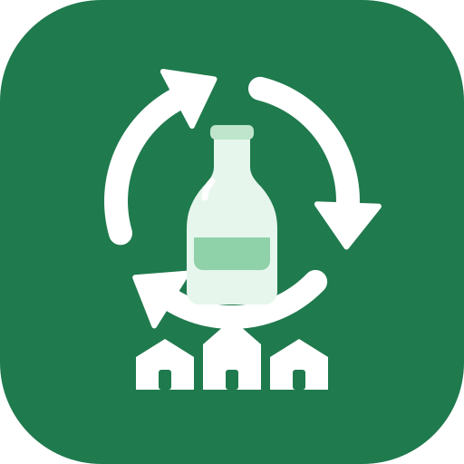

<p align="center"></p>

# Glass Collection

**A mobile-first PWA for running a neighborhood glass-recycling pickup service** — subscriber list, optimized pickup
routes, photo proof at every stop, payments, helper pay, expenses, monthly statements and tax-ready reports.

[](https://glasscollection.pages.dev)
[](https://pages.cloudflare.com/)
[](https://firebase.google.com/)
[](https://react.dev/)
[](https://www.typescriptlang.org/)
[](https://vitejs.dev/)
[](https://web.dev/progressive-web-apps/)
[](https://vitest.dev/)
[](https://github.com/lyvuong/GlassCollection/commits/main)
[](https://github.com/lyvuong/GlassCollection/stargazers)
[](LICENSE)
[-brightgreen)](#cost)

> One deployment = one family or business. To run your own, fork this repo and follow
> [Set up your own copy](#set-up-your-own-copy). There is no shared multi-tenant server and no data leaves your own
> Firebase project.

### Hello, neighbor! 👋

Every bottle and jar that gets a second life is a small win for our neighborhood, and that is exactly what this project is about. When glass pickup went away, we saw a chance to do something better together: neighbors helping neighbors, glass becoming something new instead of waste, and local teenagers earning their first paychecks while they learn what it takes to run a real service. It is a little bit of recycling, a little bit of community, and a lot of pride in doing good right where we live. Whether you are here to keep our own routes running smoothly or to start a glass-recycling crew in *your* neighborhood, welcome! We hope this makes it easy, and maybe even a little fun, and we are grateful for your help keeping glass out of the landfill and our community strong. 💚♻️

---

## Contents
- [The problem it solves](#the-problem-it-solves)
- [Features](#features)
- [How a pickup day works](#how-a-pickup-day-works)
- [Roles and permissions](#roles-and-permissions)
- [Set up your own copy](#set-up-your-own-copy)
- [Configuration reference](#configuration-reference)
- [Local development](#local-development)
- [Architecture](#architecture)
- [Data model](#data-model)
- [Cost](#cost)
- [Security and privacy](#security-and-privacy)
- [Troubleshooting](#troubleshooting)
- [Limitations](#limitations)

---

## The problem it solves

Our county stopped collecting glass for recycling. Rather than let bottles and jars go to the landfill, we decided to
work out how to recycle glass ourselves, right in our own neighborhood.

The answer is a small, neighbor-run pickup service that also **creates part-time jobs for teenagers** in the
neighborhood: they collect glass on a set schedule, earn pay from the subscription fees, and learn to run a real
small operation (routes, customer service, bookkeeping).

How it works for neighbors: each subscriber pays a flat monthly fee (default $20), **whether or not they put glass
out**, which keeps the service predictable and pays the helpers and expenses. The team needs to know who subscribes,
drive an efficient route, prove what happened at each house, track who paid, pay helpers, track expenses, and produce
statements and tax numbers at year end. This app does all of that from a phone, with no spreadsheet.

Because the problem is local and common, the project is open source: another neighborhood can
[set up its own copy](#set-up-your-own-copy) and run the same service.

## Features

### Subscribers
- Customer list with search and filters by neighborhood, route and status (active / paused).
- Name, address, phone, email, notes (for example "bin on left of garage"), monthly fee override, start date.
- Address geocoding on save (Google Geocoding when a key is set, otherwise OpenStreetMap Nominatim).
- **Pause and resume** as month ranges, so a vacation month is not billed.
- Per-subscriber pickup log: date, time, outcome and photos, handy for "you missed me" disputes.
- Email preferences: opt in/out, and frequency (every pickup, monthly only, statement only).

### Neighborhoods and routes
- Serve **several neighborhoods** from one deployment, each with its own home base, recycling-center address
  and default fee.
- Split a neighborhood into **routes** (for example subscribers 1–10 for one helper, 11–15 for another) and move
  subscribers between routes in bulk.

### Pickup planning
- Choose neighborhood and date, select who is on the list (active subscribers by default).
- **Route optimization**: Google Routes API with waypoint optimization (chunked to the 25-stop API limit), or a
  built-in nearest-neighbor + 2-opt optimizer when no Maps key is configured.
- Each route is assigned to a team member, and can be reassigned mid-day if a helper is out.
- One-tap **Navigate** deep link to Google Maps or Apple Maps for each stop.

### Collection day (mobile-first, works offline)
- Big stop cards in visiting order with address, notes and progress bar.
- **Photo at every stop**: opens the phone camera, compresses the image in the browser, and stamps it with time,
  GPS position (one reading, no continuous tracking) and who took it.
- One tap outcome: **Collected**, **Nothing out** or **Skip**, with an optional note.
- Offline-first: check-offs and photos queue locally and upload when signal returns.
- Helpers see only the routes assigned to them.

### History and proof of service
- Pickup history list by date and neighborhood.
- Map (Leaflet + OpenStreetMap) with stops colored by outcome, numbered in actual visit order, connected by a line,
  with the planned order overlaid for comparison.
- Flags check-offs made far from the subscriber's address ("far from address").
- Photo thumbnails per stop, loaded on demand.
- Close a day to hide it from helpers, and prune photos older than your retention setting.

### Money
- **Payments**: month grid of subscribers × paid/unpaid, record amount, method and date, running balances.
- **Billing rule**: every active subscriber owes the fee each month, collected or not; pauses and start dates decide
  which months are billed.
- **Expenses**: quick-add ledger with category (fuel, recycling fees, supplies, and so on), neighborhood, payee,
  note and receipt reference.
- **Helper pay**: pay rules per member (flat per day, per stop, or hourly). Closing a pickup day suggests the payout;
  you confirm or edit it.
- **Profit and loss**: monthly and annual, per neighborhood or combined, cash basis.

### Reports and statements
- Monthly **statement PDF** per subscriber: pickups that month with outcomes, fee, payments received, balance due,
  payment instructions. Download, or send through the phone share sheet.
- **Annual summary** as CSV and PDF: income, expenses by category, helper totals, and a flag for helpers whose
  yearly total reaches your reporting threshold (for example the US 1099-NEC level).
- Bookkeeping aid only, not tax advice.

### Email to subscribers (optional)
- **Pickup notice** after a pickup day: date and time, outcome, note, and *that subscriber's own photos* inline.
- **Monthly statement** email with the PDF attached.
- Review screen: untick recipients, edit the note, then send; per-recipient sent/failed status and a log to avoid
  accidental duplicates.
- Editable subject and intro templates with merge fields `{{name}}`, `{{date}}`, `{{balance}}`.
- Sent by a small Cloudflare Pages Function through Resend. It checks the caller's Firebase login and role, only
  mails the address stored for that subscriber, and enforces a daily cap.

### Team and platform
- Google sign-in or email/password with email verification.
- Roles: owner, editor, helper (see below). Invite by email from Settings → Team.
- Installable PWA with offline app shell and cached map tiles.
- Real-time sync across everyone's devices.

## How a pickup day works

1. **Plan**: Plan → choose neighborhood and date → Optimize → assign each route to a team member.
2. **Collect**: helpers open **Collect** on their phones, tap Navigate, snap the curb photo, and tap the outcome.
3. **Review**: History shows the day's map and photos; Close the day to record suggested helper payouts.
4. **Notify**: Notices → select the pickup day → send each subscriber their own photo and outcome.
5. **Bill**: Payments → record what came in. Reports → statements and monthly P&L.
6. **Year end**: Reports → annual CSV/PDF for your tax preparer.

## Roles and permissions

| | Owner | Editor | Helper |
|---|:--:|:--:|:--:|
| Collect screen for assigned routes | ✅ | ✅ | ✅ |
| Subscribers, neighborhoods, routes, planning | ✅ | ✅ | – |
| Payments, expenses, payouts, reports, emails | ✅ | ✅ | – |
| Settings, team and invites | ✅ | – | – |
| See other routes' stops and photos | ✅ | ✅ | – |

These are enforced by Firestore security rules, not only by the UI.

---

## Set up your own copy

Time: about 45 minutes. You need a GitHub account, a Google account, and a Cloudflare account (all free). A credit
card is needed only if you enable Google Maps; the app works without it.

### 1. Fork the repo
Click **Fork** (or **Use this template** if enabled) on https://github.com/lyvuong/GlassCollection and clone your copy:

```bash
git clone https://github.com/<you>/GlassCollection.git
cd GlassCollection
npm install
```

Requires Node 20 (`.nvmrc`).

### 2. Create the Firebase project (free Spark plan)
1. [Firebase console](https://console.firebase.google.com) → **Add project** (skip Analytics).
2. **Build → Authentication → Get started** → enable **Google** and **Email/Password**.
3. **Build → Firestore Database → Create database** → production mode, pick a nearby location.
4. **Project settings → Your apps → Web (`</>`)** → register an app and copy the config values.

> Do **not** upgrade this project or link a billing account to it. Keeping it on Spark guarantees you are never charged.

### 3. Set the owner and deploy security rules
1. Open `firestore.rules` and change `owner@example.com` in `OWNER_EMAIL()` to the email the owner will sign in with.
   That person's first **verified** sign-in becomes the owner.
2. Deploy rules and indexes:

```bash
npm i -g firebase-tools
firebase login
firebase deploy --only firestore --project <your-firebase-project-id>
```

### 4. Configure local environment (optional, for development)
```bash
cp .env.example .env.local     # then fill in the VITE_FIREBASE_* values
npm run dev
```
`.env.local` is git-ignored. Never commit keys.

### 5. Host on Cloudflare Pages
1. Cloudflare dashboard → **Workers & Pages → Create → Pages → Connect to Git** → select your fork.
   If the branch list is empty, grant the Cloudflare GitHub app access to the repo
   (GitHub → Settings → Applications → Cloudflare Workers and Pages → Configure).
2. Build settings:

   | Setting | Value |
   |---|---|
   | Production branch | `main` |
   | Build command | `npm run build` |
   | Build output directory | `dist` |

3. **Settings → Environment variables (Production)**: add `VITE_FIREBASE_API_KEY`, `VITE_FIREBASE_AUTH_DOMAIN`,
   `VITE_FIREBASE_PROJECT_ID`, `VITE_FIREBASE_APP_ID` (and `VITE_GOOGLE_MAPS_KEY` if used).
4. Redeploy once after saving variables (Vite reads them at build time). Every later push to `main` deploys automatically.
5. Back in Firebase: **Authentication → Settings → Authorized domains → Add** your `*.pages.dev` domain
   (and custom domain, if any). Google sign-in fails without this.

### 6. First run
1. Open the site and sign in with the owner email (verify the email if you used a password).
2. **Settings**: business name, default fee, payment instructions, expense categories.
3. **Areas**: add a neighborhood, enter home base and recycling-center addresses, click *Locate addresses*,
   and add routes if you will split the work.
4. **Customers**: add subscribers (or import by hand), confirm each geocoded pin.
5. **Settings → Team**: invite family and helpers by email, with role and (for helpers) their routes.
6. **Plan** a pickup day, then **Collect** from a phone and install the PWA (browser menu → Add to Home Screen).

### 7. Optional: Google Maps (better optimization and geocoding)
1. Create a **separate** Google Cloud project (not the Firebase one) and attach billing.
2. Enable **Geocoding API** and **Routes API**.
3. Create an API key, restrict it by **HTTP referrer** to your `pages.dev` / custom domain, and restrict it to those
   two APIs. Add a budget alert.
4. Set `VITE_GOOGLE_MAPS_KEY` in Cloudflare and redeploy.

Typical usage (geocode once per new subscriber, a few route calls per pickup day) stays inside Google's free monthly
credit. Without a key the app uses OpenStreetMap geocoding and the built-in optimizer.

### 8. Optional: email notices and statements
1. Create a [Resend](https://resend.com) account and verify a sender address or domain (SPF/DKIM).
2. In Cloudflare Pages → Settings → Variables and secrets, add as **encrypted** (not `VITE_`):

   | Variable | Value |
   |---|---|
   | `EMAIL_API_KEY` | Resend API key |
   | `EMAIL_FROM` | `Glass Pickup <pickup@yourdomain.com>` |
   | `EMAIL_REPLY_TO` | your family contact address |
   | `FIREBASE_PROJECT_ID` | same as the Firebase project id |
   | `DAILY_SEND_CAP` | optional, default 100 |

3. Redeploy. Use **Notices** to send; do a test to yourself first.

Skip this step and use **Reports → PDF / Share** to send statements manually.

---

## Configuration reference

| Variable | Where | Required | Purpose |
|---|---|:--:|---|
| `VITE_FIREBASE_API_KEY` | build | ✅ | Firebase web config (public value) |
| `VITE_FIREBASE_AUTH_DOMAIN` | build | ✅ | Firebase web config |
| `VITE_FIREBASE_PROJECT_ID` | build | ✅ | Firebase web config |
| `VITE_FIREBASE_APP_ID` | build | ✅ | Firebase web config |
| `VITE_GOOGLE_MAPS_KEY` | build | – | Geocoding + route optimization |
| `EMAIL_API_KEY` | Pages secret | – | Resend key for email |
| `EMAIL_FROM` | Pages secret | – | Sender address |
| `EMAIL_REPLY_TO` | Pages secret | – | Reply-to address |
| `FIREBASE_PROJECT_ID` | Pages secret | – | Lets the function verify logins |
| `DAILY_SEND_CAP` | Pages secret | – | Max emails/day (default 100) |

In-app **Settings** (owner): business name, default fee, currency, statement footer, payment instructions, expense
categories, helper reporting threshold, mileage rate, photo retention days, email subject/intro, contact email.

## Install on a phone

The app is a PWA: after installing it opens full screen like a native app, has its own icon, and keeps working with a
weak or missing signal (check-offs and photos queue and upload later). The same instructions are shown in the app on the
sign-in screen.

### iPhone and iPad (Safari)
1. Open your site in **Safari**. On iOS, installing is done from Safari's Share menu; iOS shows no install banner.
2. Tap the **Share** button (square with an up arrow; in the address bar or the bottom toolbar).
3. Scroll down and tap **Add to Home Screen**. Keep the name **Glass** (or rename it) and tap **Add**.
4. Open the app from the new home-screen icon, sign in, and allow **Camera** and **Location** when the first
   photo is taken.

Notes: iOS 16.4+ also allows installing from other browsers' Share menus. If Google sign-in fails inside the installed
app, use email and password. To get a new icon after a logo change, delete the shortcut and add it again.

### Android (Chrome)
1. Open your site in **Chrome**.
2. Tap the **⋮** menu, then **Install app** (some versions say **Add to Home screen**). You may also see an
   install banner at the bottom.
3. Tap **Install**. The app appears in your app drawer and home screen.
4. Open it, sign in, and allow **Camera** and **Location** on the first photo.

### Desktop (Chrome / Edge)
Click the install icon at the right end of the address bar, or menu -> **Install Glass Collection**.

### After installing
- Always launch from the home-screen icon so check-offs run in the installed app.
- Updates arrive automatically: when a new version is deployed you will see a banner with **Update now**.
- Helpers only need the link, an invite from the owner, and these steps; no app store is involved.

## Versions and updates

- **Automatic versioning**: [release-please](https://github.com/googleapis/release-please) reads
  [Conventional Commits](https://www.conventionalcommits.org/) on `main` (`fix:` bumps patch, `feat:` bumps minor,
  `feat!:` bumps major) and keeps a release PR open that updates `package.json` and `CHANGELOG.md`. Merging it creates a
  tag and a GitHub release. One-time: GitHub repo -> Settings -> Actions -> General -> enable
  *Allow GitHub Actions to create and approve pull requests*.
- **Version shown in the app**: the footer shows `v<version> · <commit>` (from `package.json` and the deployed commit).
- **In-app update prompt**: the PWA checks for a new deployment every 30 minutes and whenever it returns to the
  foreground, then shows *A new version is available* with **Update now / Later**. It never reloads by itself, so a helper
  in the middle of a pickup does not lose queued photos or check-offs.
- **CI**: `.github/workflows/ci.yml` runs tests and a build on every push and pull request.

## Local development

```bash
npm install
npm run dev       # dev server, needs .env.local
npm test          # billing, pay and route logic (Vitest)
npm run build     # type-check + production build into dist/
npm run preview   # serve the production build
```

## Architecture

```
Browser (React PWA, Leaflet map, jsPDF)
   │  Firebase Auth + Firestore (offline cache, real-time sync, role rules)
   │  Google Geocoding / Routes   (optional, from the browser, referrer-restricted key)
   └─ POST /api/send-email ──► Cloudflare Pages Function ──► Resend
                               (verifies Firebase ID token, role,
                                recipient == stored subscriber email, daily cap)
```

| Area | Choice |
|---|---|
| UI | Vite, React 18, TypeScript, React Router |
| PWA | vite-plugin-pwa (offline shell, OSM tile cache) |
| Data | Firestore with persistent local cache |
| Auth | Firebase Auth (Google, email/password) |
| Maps | Leaflet + OpenStreetMap; Google Maps Platform optional |
| PDFs | jsPDF + jspdf-autotable, generated in the browser |
| Email | Cloudflare Pages Function + Resend |
| Hosting | Cloudflare Pages, auto-deploy from GitHub `main` |

Key folders: `src/pages` (screens), `src/lib` (billing, pay, geo, routing, pdf, mailer, data),
`functions/api/send-email.ts` (email function), `firestore.rules` (security).

## Data model

Firestore collections at the root of your project:
`members`, `invites`, `settings/app`, `neighborhoods`, `routes`, `customers`, `collections/{id}/stops/{customerId}`
(with a `photos` subcollection), `payments`, `expenses`, `payouts`, `emails`.

## Cost

| Service | Plan | Typical monthly cost |
|---|---|---|
| Firebase (Auth + Firestore) | Spark (free) | $0 |
| Cloudflare Pages + Functions | Free | $0 |
| Google Maps Platform | Free monthly credit, billing account required | $0 at this volume (optional) |
| Resend | Free tier | $0 (a sender domain is about $10/year) |

Photos are compressed to roughly 100–250 KB and stored in Firestore (Firebase Storage needs a paid plan). Retention
pruning keeps usage far below Spark's 1 GiB. If you outgrow it, the photo store can move to Cloudflare R2.

## Security and privacy

- Everything is gated by Firestore rules: only members read or write; helpers see only their assigned routes' stops and
  photos and cannot see payments or reports; only the owner changes team and settings.
- Firebase web config values are public by design; security comes from Auth + rules. Restrict your Maps key by referrer.
- Server secrets live only in Cloudflare encrypted variables. `.env.local` is git-ignored: **never commit keys**.
- The email function cannot be used as an open relay: it needs a valid owner/editor login, sends only to the stored
  subscriber address, and has a daily cap.
- Photos show the curb or bin, not people. Tell subscribers at sign-up that curbside photos are taken and emailed as
  proof of service. Photos are visible only to members with access to that route.

## Troubleshooting

| Symptom | Fix |
|---|---|
| "Firebase is not configured" | `VITE_FIREBASE_*` missing at build time; add in Cloudflare and redeploy |
| Google sign-in popup error | Add your domain to Firebase → Authentication → Authorized domains |
| "Access denied" after sign-in | `OWNER_EMAIL()` doesn't match, rules not deployed, or the email is not verified; for others, add an invite |
| Cloudflare branch dropdown empty | Re-authorize the Cloudflare GitHub app for the repo |
| Optimizer says no key | Expected without `VITE_GOOGLE_MAPS_KEY`; the local optimizer is used |
| Email send fails | Check the Pages secrets, sender verification in Resend, and the subscriber has an email and opt-in |
| Helpers see nothing | Assign them routes in Settings → Team and assign the route on the pickup day |

## Limitations

- Single tenant by design: each family deploys its own copy.
- Not yet verified against a live Firebase project in automated tests; Firestore rules have no emulator test suite yet.
- Email, Google Maps and offline photo sync need real accounts and a phone to exercise fully.
- Reports are a bookkeeping aid, not tax advice. Confirm reporting thresholds with a tax professional.

## Contributing

Issues and pull requests are welcome. Run `npm test` and `npm run build` before opening a PR.
Released under the [MIT License](LICENSE).
